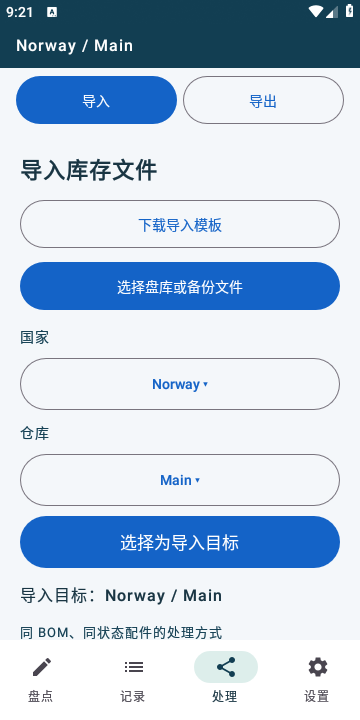
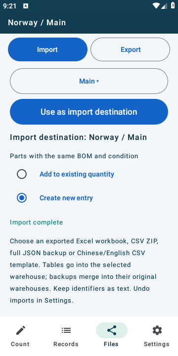

# 2.4.3 导入兼容验证

2026-10-30，版本 2.4.3 / versionCode 9，数据库 schema 5。

导入入口识别标准 CSV、导出的报告 CSV/ZIP、Excel 明细和完整 JSON 备份。表格仍导入所选仓库，JSON 使用原有完整合并确认，保留原国家、仓库、记录、作废及修改历史。界面说明精简为一个底部文本块。

## 已完成检查

- 151 项单元检查通过。其中新增 8 项覆盖旧版无 PN 报告、Excel 共享字符串和空单元格、前导零与大小写、多行备注、公式及损坏文件拒绝、旧/新 JSON 备份、跨格式重复内容提醒及下载样本。
- Excel、报告 CSV 和 CSV ZIP 都在两种界面语言下交叉读取；设备流程分别验证中文 Excel 导入英文界面、英文 Excel 导入中文界面。中文空模板也通过英文界面的同一选择入口读取。
- 下载的 Excel 含 380 条配件、20 条整机，共 400 条有效明细；与完整 v1 备份的类型、BOM、SN、PN、数量、状态和备注逐项一致。配件汇总及说明未重复导入。用户样本仅用于本地验证，未打入 APK、源码或仓库。
- API 28 模拟器上的正式 APK 完成 9 项设备/界面检查：4 项导入流程、1 项下载文件实测、3 项原双语流程、1 项导出恢复流程。下载样本分别执行表格导入和完整备份合并，均为 400 条；同一 JSON 再次合并新增 0 条，原修改历史保留。
- 文件选择、预览和确认相互分开；取消备份确认、选择空模板或校验失败的备份均未写入库存。读取失败清除旧预览，避免随后误导入上一份文件。
- 同签名客户版 2.4.2（8）直接覆盖为 2.4.3（9），保留原库存、备注、仓库、语言及审计；沿用既有升级保留测试验证，再检查 PN 修改及备份回读。
- `assembleRelease`、`assembleReleaseAndroidTest -PtestBuildType=release`、`lintRelease` 通过。Lint 为 0 错误、1 项原有警告。发布签名沿用客户版固定签名。

## 界面核对

上方直接提供下载模板和选择文件，说明位于仓库、处理方式及预览之后。截图均使用合成测试数据。

## 使用边界

表格上限仍为 8 MiB / 10000 条，压缩内容总量最多 64 MiB；完整 JSON 保持 32 MiB。表格追加库存，不还原原记录 ID、审计和作废记录；完整迁移使用 JSON。同 ID 内容冲突仍整批停止，新增重复 SN 仍按原规则转作废。

报告 CSV 中为 Excel 添加的安全单引号按文件原文保留。Excel 和 JSON 可保留原始备注。表格字段包含公式时要求先改为实际值，不执行公式或读取外部引用。

设备流程通过测试提供文件选择器返回值，实际下载文件另在正式 APK 中完成解析、写入和备份合并；尚未在实体手机及第三方网盘文件提供器上验证。
