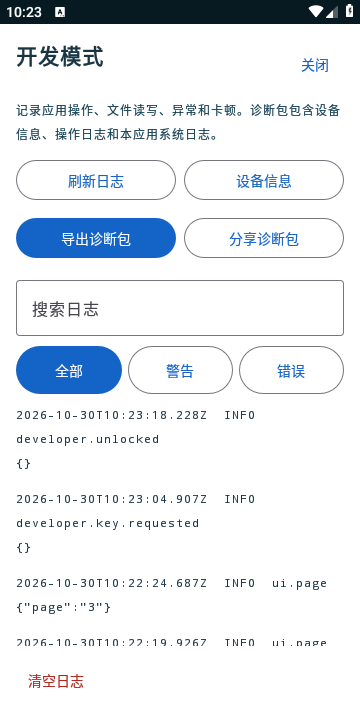

# 2.4.4 开发诊断与导入返回验证

2026-10-30，2.4.4 / versionCode 10，schema 5。

## 问题与修复

旧版文件回调在 `busy` 为真时直接返回。首次初始化或回到应用后的备份检查与所选文件返回重叠时，文件会被丢弃，界面也没有结果。新增回归测试在旧实现中失败，修复后通过。

文件和备份回调现在等待已有操作完成；读取过程有可见提示，成功后自动将预览和确认区滚动到屏幕中。导入确认及备份合并也支持等待后台操作，保留整批确认和回滚规则。

## 开发诊断

- 设置底部版本文字前五次点击没有提示或波纹，第六次请求开发验证；错误输入不能进入。验证状态及输入不持久化。
- 日志从应用启动开始，记录页面/活动生命周期、文件选择与取消、提供器/文件名/大小/格式、排队、读取行数、确认、成功或异常堆栈、备份、导出及扫描状态。日志不记录开发验证输入。
- 本机最多四个滚动日志文件，每份 512 KiB；界面显示最近 300 条匹配记录。支持搜索、全部/警告/错误、刷新、设备信息、导出/分享、清空确认。
- 未捕获异常同步落盘后继续系统崩溃处理；前台主线程超过约 6 秒未响应时记录堆栈。诊断包包含设备、存储及库存数量统计、全部保留操作日志、本应用进程 logcat；Android 11+ 尝试补充最近进程退出原因。不可读取系统日志时保留原因和其他诊断文件。
- 真实密钥及本地配置内容不进入代码、PR、源码包、说明或日志。本地仅配置单向校验值，由构建注入；公开源码不带实际校验值。

## 已完成验证

- **156 项单元检查**通过，包括忙碌状态的文件返回回归、六次入口与精确验证、日志容量轮换、重开保留、错误详情与敏感字段隐藏、诊断包和原有导入/导出/备份检查。
- **13 项 Release 设备流程**通过：新增开发入口、忙碌时返回下载样本、JSON 排队、日志筛选/导出/清空，以及既有双语、导出恢复和文件导入流程。下载样本 400 条在后台操作忙时返回后仍能读取、自动显示确认并完整导入。
- 另通过安卓真实 DocumentsUI 选择下载的 Excel，返回后直接显示 400 行及确认按钮；实际私有配置完成六次点击与正确验证，并通过真实系统保存界面导出 ZIP。
- 实际导出的诊断 ZIP 包含 `environment.json`、操作 JSONL、`app-logcat.txt` 及说明。检查未发现明文密钥或开发校验值。
- 客户版 **2.4.3（9）→ 2.4.4（10）**原地覆盖升级通过，旧库存、备注、仓库、语言和审计保留。固定客户发布签名保持一致。
- 正式包、Release 测试包和发布 Lint 构建通过，Lint 为 0 错误、1 项已有提示。发布前检查源码和安装包，排除明文密钥、签名文件与本地私有配置。

设备检查使用 API 28 模拟器。尚未在用户实体手机上验证；如仍有问题，复现后导出诊断包即可区分文件未返回、读取受阻、格式失败及尚未确认等阶段。安卓系统日志范围限应用可读取的信息。
