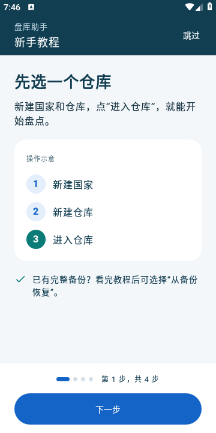
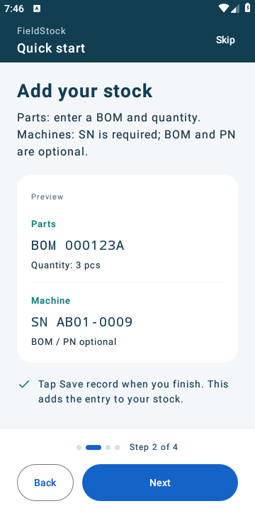
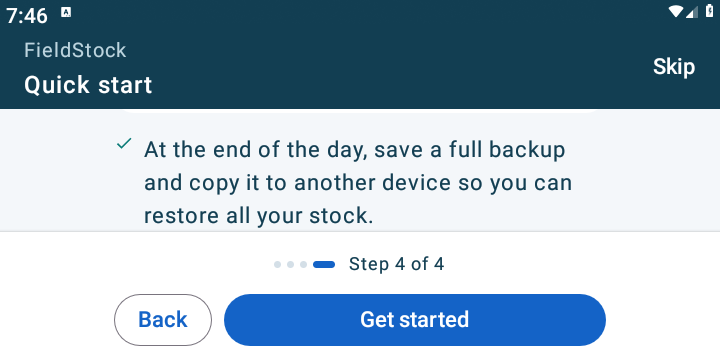

# 2.4.4 新手教程验证

2026-11-03。versionName **2.4.4**、versionCode **10**、数据库 schema **5** 和固定客户签名保持不变。诊断修订标识为 `2.4.4-tutorial-20261103`。

## 行为

首次选择中文或 English 后显示四步教程，内容随所选语言显示：

1. 新建国家和仓库，再进入盘点；已有完整备份可在教程结束后恢复。
2. 配件输入 BOM 和数量；整机只必填 SN，BOM/PN 选填；点保存后计入库存。
3. 用扫描识别印刷标签或多行备注，核对编号、确认填入，再保存记录。
4. 在记录页搜索、核对和修改，在处理页导出报表、保存完整备份，并复制到其他设备。

每页包含简短说明和操作示意。可左右滑动、点下一步/上一步；底部进度和按钮固定，小屏、横屏或大字体下说明可滚动。旋转保留当前步骤。自动教程中按系统返回键先回到上一步，第一步返回相当于跳过。

语言与待显示标记在同一次偏好保存中写入，重建后进入教程。看完或跳过后保存独立的完成状态，不按版本号重置；重启、覆盖升级或切换语言后都不再自动显示。完成状态优先于后续的待显示请求。未完成就关闭应用，下次仍可查看教程。已有语言选择的安装覆盖升级时不自动弹出；设置中的语言切换也不重新触发教程。

设置新增“查看新手教程 / View quick start”。重看使用全屏窗口，关闭后返回原页面，保留当前仓库、未保存的输入和库存。示例编号、数量仅用于界面讲解，不写入数据库，也不会自动请求扫描权限。

## 检查结果

| 检查 | 结果 |
| --- | --- |
| 单元 / Robolectric | **214 项通过，0 失败、0 错误、0 跳过**。新增 4 项验证首次语言与教程状态持久化、完成/跳过保留其他偏好、老用户及语言切换的行为，以及完成后重复请求教程仍不自动打开。 |
| 新教程 Release 流程 | **6 项通过**：英文完整四步、滑动及返回、旋转保留；中文跳过及下次启动；未完成后重启；设置重看保留输入和库存；中英切换后的重看；横屏配合 1.5 倍字体时说明可滚动、操作按钮可见。 |
| 相关现有 Release 流程 | **16 项通过**：双语 3、审查热修 5、开发诊断 4、盘点 4。包含原诊断文件结果重建流程，确认启动分支调整后仍正常。 |
| 原包覆盖安装 | **1 项升级检查通过**。实际安装上一轮正式审查包，写入合成库存与偏好后 `install -r` 覆盖教程包，保留记录、备注、选中仓库、语言及审计，可继续编辑 PN。启动显示仓库选择，未自动弹教程。 |
| 教程完成后覆盖安装 | **1 项检查通过**。实际从首次语言选择开始完成四步教程，再以 `install -r` 重新安装同版本正式 APK；完成状态和所选语言保留，启动显示仓库选择，未再次弹教程。此检查不清空应用数据，不依赖版本号。 |
| 构建 | `testDebugUnitTest`、`assembleRelease`、`assembleReleaseAndroidTest -PtestBuildType=release`、`lintRelease` 通过。Lint **0 错误、13 警告**，与上一交付的检查结果一致。 |

共 **24 项 Release 设备流程**通过，均使用专用 API 28 模拟器。补充完成状态后，新教程 6 项和相关现有 16 项在最终安装包上复查通过。实际教程截图逐页检查中英文各四页及横屏大字体，未发现文字截断或操作按钮不可达。截图使用界面内示意数据；现有库存保护检查使用合成记录。

正式 APK、源码 ZIP 与 SHA256 文件同步更新至 `artifacts`，发布证书和四种 ABI 保留。公开源码不包含签名、密码配置、私有开发验证配置、工具链或实际库存样本。安装包与源码归档解压检查不含明文开发密钥。

## 界面

横屏 1.5 倍字体，下图为滚动到最后一页说明底部，进度和操作按钮固定可见：

