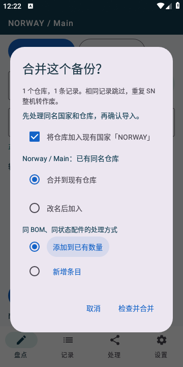
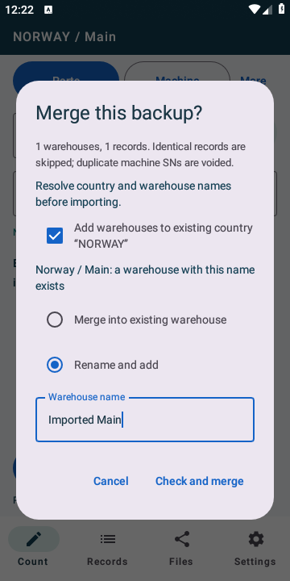

# 2.4.4 热修验证

2026-10-30。versionName **2.4.4**、versionCode **10**、数据库 schema **5** 和客户发布签名均保持不变。诊断环境及启动记录增加 `revision: 2.4.4-hotfix-20261030`，用于区分同版本安装包。

## 问题与修复

用户设备日志在点击盘点页“更多”时记录 `ActiveParent with no focused child`，堆栈位于清除输入焦点。打开/关闭弹窗现在由弹窗管理焦点，仅显式收起键盘；盘点区域改用普通布局尺寸回调，避免键盘变化时对子布局重新组合。保存、切页和扫描前的焦点清理只对这个已知异常提供带日志的恢复，其他异常继续抛出。

完整备份与本机同名国家使用不同 ID 时，旧版将其视为重名错误。热修先显示冲突选项，再统一执行：

- 同名国家：确认将备份仓库归入现有国家。
- 同名仓库：合并到现有仓库，或输入不重名的新仓库名称后加入。
- 合并仓库：同 BOM、同状态的配件选择新增条目或添加到已有数量；新增重复 SN 整机仍转作废。
- 原始记录及合并来源历史归档保留。同一备份再次导入跳过已处理来源，防止重复加数量；后续手动合并配件或仓库时仍保留来源标记。备份可再次导出、回读和迁移，重要操作可通过恢复点撤销。

输入校验、名称映射、数据写入、来源标记与恢复点在事务中完成。取消不写入，数量超限、无效名称、重名新名称或记录冲突整批回滚。中英文界面使用相同规则。

## 验证结果

- **172 项单元检查，0 失败、0 跳过**。新增检查覆盖同名国家、仓库两种处理、数量两种方式、多仓库混合处理、反复导入、来源历史、后续合并、完整备份回读、撤销、数量溢出、重复 ID、冲突内容及重复 SN/PN。用本机提供的旧版完整备份在两种语言下验证合并后配件总量及整机保留、再次导入不增加数量；原始样本不进入仓库或源码包。
- **17 项 Release 设备流程通过**。新增四项覆盖反复输入/收起键盘/打开“更多”/编辑多行备注/切页、中文增加数量及重复导入、英文仓库改名、英文新增条目与取消。原双语、文件返回、实际 400 行样本、导出恢复和开发诊断设备流程继续通过。
- 原客户版 **2.4.4（10）→ 热修 2.4.4（10）** 实际 `install -r` 覆盖成功；既有库存、备注、国家/仓库、语言、选中仓库和审计保留，并可继续编辑 PN。
- Release 构建、Release 测试包与 `lintRelease` 通过。Lint 无错误；提示为依赖版本建议、已有备份提取规则与状态装箱信息。
- 正式 APK 校验固定客户证书、非调试属性及四种 ABI。公开源码包排除签名文件、本地验证配置、工具链、实际样本和生成文件；发布前检查源码和 APK 解压内容，排除明文开发密钥。

设备流程使用 API 28 模拟器；尚需用户实体手机确认原有 Vivo 焦点闪退不再出现。旧日志仍可能包含热修安装前的崩溃，可按发生时间及启动记录中的 revision 区分。

## 界面

下图均使用合成测试数据。

